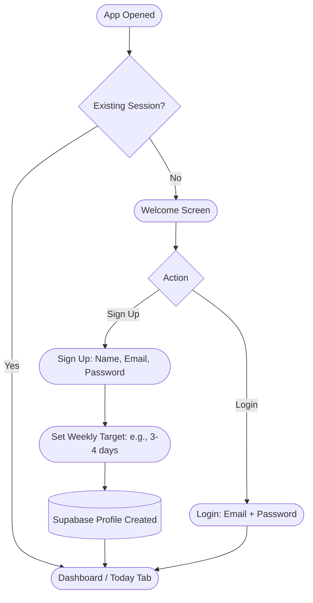
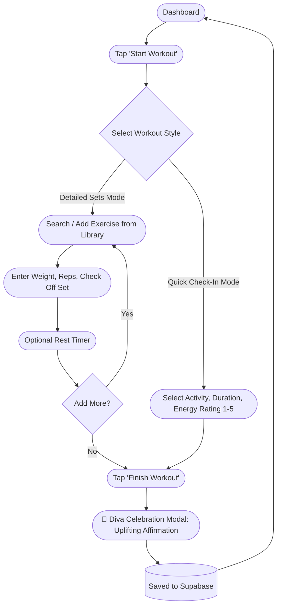
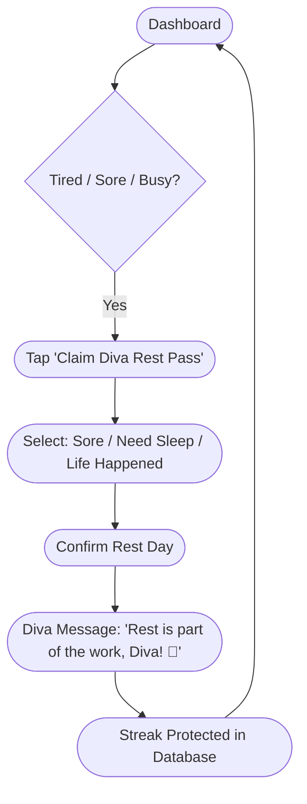

# Product Specification: It's okay DIVA

> **"Show up when you can. Forgive yourself when you can't. You're still a DIVA."**

---

## 1. Executive Summary & Vision

**It's okay DIVA** is an anti-burnout, empowering fitness tracking app tailored for fitness beginners and intermediate lifters who struggle with traditional "all-or-nothing" fitness culture. Most fitness trackers penalize users with broken streaks, red alerts, and guilt when life gets in the way. 

**It's okay DIVA** turns fitness into a sustainable, uplifting journey by offering:
- **Hybrid Workout Logging:** Fast set-by-set logging for strength training or quick, single-tap activity check-ins for brisk walks, pilates, or home workouts.
- **Guilt-Free Consistency Engine:** "Diva Rest Passes" that preserve progress streaks on recovery days, paired with encouraging, supportive tone-of-voice copy.
- **Curated Starter Library:** 30+ beginner-friendly exercises with clear movement cues, plus full support for custom movements.
- **Lean Architecture:** Expo (React Native), TypeScript, Supabase (Auth + Postgres), Zustand for ultra-responsive local state.

---

## 2. Target User Personas

### Persona A: "Comeback Chloe" (The Perfectionist in Recovery)
- **Demographics:** 26 years old, hybrid corporate worker, former athlete/gym-goer who stopped exercising for 9 months due to burnout.
- **Pain Points:** 
  - Gets discouraged the second she misses a day on an aggressive 7-day streak.
  - Finds heavy gym apps (like Strong or Hevy) overly technical and cold.
  - Feels guilty if she only has 20 minutes to do yoga or bodyweight squats.
- **Needs:** Validation that small efforts count, a forgiving streak system ("Diva Pass"), and simple, quick tracking.
- **Quote:** *"I want to work out without feeling like a failure if I have to skip a session for an emergency deadline."*

### Persona B: "Beginner Bianca" (The Gym/Home Newbie)
- **Demographics:** 22 years old, college senior/entry-level professional, working out at home with dumbbells and trying the gym for the first time.
- **Pain Points:**
  - Intimidated by complex bodybuilding jargon (RPE, 1RM, supersets).
  - Unsure how many sets/reps to do or what exercise is called.
  - Wants to track progress without carrying a notebook or dealing with bloated menus.
- **Needs:** A curated exercise list with clear muscle targets, effortless set logging, and post-workout positive reinforcement.
- **Quote:** *"Just tell me what to do and celebrate that I actually showed up today."*

---

## 3. MVP Scope vs. Future Roadmap (2-Week MVP)

To ship a rock-solid, production-quality app within **2 weeks**, features are strictly segmented:

| Feature Area | In Scope for 2-Week MVP 🚀 | Deferred to Post-MVP (v1.1+) ⏳ |
| :--- | :--- | :--- |
| **Authentication** | Supabase Email & Password Auth, Session persistence via SecureStore, Forgot Password | Apple Sign-In, Google OAuth, Biometric login (FaceID) |
| **Profile** | Display Name, Fitness Goal selection, Weekly Workout Target (e.g. 3-4 days/week) | Avatar upload, Weight history graph, Measurement tracking |
| **Workout Logging** | **Hybrid Logging:**<br>1. Detailed mode: Sets, Weight, Reps, Bodyweight toggle, rest timer.<br>2. Quick mode: Activity type, duration, energy/feeling rating (1-5), notes. | Rest pause sound effects, Plate calculator, Supersets & drop-sets, Video demo clips |
| **Consistency System** | **Diva Rest Pass:** Weekly quota of forgiven rest days that maintain active weekly streak. Supportive post-workout affirmation modal. | Social streak sharing, AI Coach cheerleading messages, Apple Health / Health Connect sync |
| **Exercise Library** | Pre-seeded SQLite/Postgres library of ~30 common exercises (Upper, Lower, Core, Full Body, Cardio). Custom exercise creation. | GIF animations, Exercise substitution suggestions, Filter by specific gym machines |
| **History & Stats** | Chronological workout history list, Weekly consistency bar/dots, Total workouts completed, Personal Best badge per exercise. | 1RM charts, Muscle heatmaps, Volume graphs, CSV export |
| **State & Sync** | Supabase Postgres with Zustand local cache & optimistic UI updates. | Full peer-to-peer offline sync queue, Background syncing |

---

## 4. Primary User Flows

### Flow 1: Onboarding & Authentication


---

### Flow 2: Hybrid Workout Logging


---

### Flow 3: Guilt-Free "Diva Rest Pass" Check-in


---

## 5. Screen List & Information Architecture

All navigation follows file-based routing with **Expo Router**:

```text
app/
├── (auth)/
│   ├── _layout.tsx
│   ├── login.tsx            # Login with email/password + validation
│   └── sign-up.tsx          # Name, email, password, weekly target
├── (tabs)/
│   ├── _layout.tsx          # Custom tab bar with Diva brand accents
│   ├── index.tsx            # Today / Dashboard screen
│   ├── workout.tsx          # Workout Hub (Start Empty, Templates)
│   ├── history.tsx          # Past logs & Consistency Calendar
│   └── profile.tsx          # User profile, weekly target, settings & logout
└── (modals)/
    ├── active-workout.tsx   # Live workout tracker (detailed & quick toggle)
    ├── exercise-picker.tsx  # Searchable exercise modal + 'Add Custom'
    ├── rest-pass.tsx        # 'It's okay DIVA' rest pass redemption modal
    └── celebration.tsx      # Post-workout affirmation & summary card
```

### Detailed Screen Specifications

#### 1. Today / Dashboard (`/(tabs)/index.tsx`)
- **Header:** Personalized greeting ("Hey Diva, [Name] ✨"), Current Weekly Goal Progress (e.g. `2/3 workouts done`).
- **Hero Card:** 
  - Dynamic status: "Ready to move today?" or "Rest pass active for today ✨".
  - Quick action buttons: **[Start Workout]** and **[Take a Diva Rest Day]**.
- **Weekly Consistency Strip:** 7-day pill bar showing completed workouts (⭐️), rest passes (💅), or upcoming days.
- **Daily Uplift:** A rotating supportive fitness quote / affirmation.

#### 2. Active Workout Screen (`/(modals)/active-workout.tsx`)
- **Segmented Control at Top:** Toggle between **[Detailed Sets]** and **[Quick Check-in]**.
- **Detailed View:**
  - Elapsed workout timer at top.
  - Exercise cards containing: Exercise name, muscle tag, set rows (`Set #`, `Previous Weight/Reps`, `Lbs/Kg`, `Reps`, `Checkmark button`).
  - **[+ Add Exercise]** button opening the exercise picker modal.
  - Floating Finish button with confirmation alert.
- **Quick Check-in View:**
  - Activity picker dropdown/chips (e.g., Brisk Walk, Yoga/Pilates, Core, Dance, Cycling, Home HIIT).
  - Duration input (minutes).
  - Energy rating slider or emoji selector (😴 Tired, ⚡️ Energized, 🔥 Unstoppable).
  - Optional short note ("Did 20 mins while watching favorite show!").

#### 3. Exercise Picker & Creator (`/(modals)/exercise-picker.tsx`)
- Search bar with instant debounced filtering.
- Filter chips: All, Chest, Back, Legs, Shoulders, Arms, Core, Cardio.
- Pre-populated library of 30 common movements.
- **[+ Create Custom Exercise]** footer button for custom name and muscle group.

#### 4. History Screen (`/(tabs)/history.tsx`)
- **Top Stats:** Total Workouts Logged, Total Diva Passes Claimed, Active Week Streak.
- **Monthly / Weekly Calendar Strip:** Visual dots indicating workout vs rest days.
- **Past Logs Feed:** Grouped by date; each card displays workout title, duration, total volume or quick notes, and an expand toggle to view individual sets.

#### 5. Profile & Settings (`/(tabs)/profile.tsx`)
- User info (Name, Email, Account creation date).
- Preferences: Weight units (`kg` vs `lbs`), Weekly workout target (1 to 7 days).
- Supabase session management: **[Sign Out]** button with confirmation modal.

---

## 6. Database Schema (Supabase Postgres)

Strict relational schema with Row Level Security (RLS) enabled on all tables:

```sql
-- 1. PROFILES (extends Supabase auth.users)
create table public.profiles (
  id uuid references auth.users on delete cascade primary key,
  display_name text not null,
  weekly_goal int default 3 check (weekly_goal between 1 and 7),
  unit_preference text default 'lbs' check (unit_preference in ('lbs', 'kg')),
  created_at timestamp with time zone default timezone('utc'::text, now()) not null
);

-- 2. EXERCISES (predefined system exercises + user custom exercises)
create table public.exercises (
  id uuid default gen_random_uuid() primary key,
  user_id uuid references public.profiles(id) on delete cascade, -- null = global/system exercise
  name text not null,
  category text not null check (category in ('chest', 'back', 'legs', 'shoulders', 'arms', 'core', 'cardio', 'full_body')),
  equipment text default 'none',
  is_custom boolean default false not null,
  created_at timestamp with time zone default timezone('utc'::text, now()) not null
);

-- 3. WORKOUTS (individual logged workout sessions)
create table public.workouts (
  id uuid default gen_random_uuid() primary key,
  user_id uuid references public.profiles(id) on delete cascade not null,
  title text not null default 'Workout Session',
  workout_type text not null check (workout_type in ('detailed', 'quick')),
  duration_minutes int default 0 not null,
  energy_rating int check (energy_rating between 1 and 5),
  notes text,
  completed_at timestamp with time zone default timezone('utc'::text, now()) not null
);

-- 4. WORKOUT_SETS (sets performed in detailed workouts)
create table public.workout_sets (
  id uuid default gen_random_uuid() primary key,
  workout_id uuid references public.workouts(id) on delete cascade not null,
  exercise_id uuid references public.exercises(id) on delete cascade not null,
  set_number int not null,
  weight numeric(6, 2) default 0,
  reps int not null,
  is_completed boolean default true not null,
  created_at timestamp with time zone default timezone('utc'::text, now()) not null
);

-- 5. REST_DAYS (Diva Rest Passes logged by user)
create table public.rest_days (
  id uuid default gen_random_uuid() primary key,
  user_id uuid references public.profiles(id) on delete cascade not null,
  rest_date date default current_date not null,
  reason text,
  affirmation text,
  created_at timestamp with time zone default timezone('utc'::text, now()) not null,
  unique (user_id, rest_date)
);
```

---

## 7. Success Metrics & KPIs (MVP)

1. **North Star Metric:** **Weekly Consistency Rate** (% of active users who log at least their target number of workouts or validated Diva Rest Passes per week; target: **> 70%**).
2. **Friction-to-Log:** Median time to log a workout:
   - Quick check-in: **< 30 seconds**.
   - Detailed set: **< 10 seconds per set**.
3. **Streak Retention:** 14-day user retention compared to traditional fitness apps (benchmarking against churn caused by broken streaks).
4. **Rest Pass Engagement:** At least 80% of users who face an off-day use the "Diva Rest Pass" rather than abandoning the app.

---

## 8. 2-Week MVP Development Roadmap

```
Week 1: Foundations, Data Model & Core Workflows
├── Day 1-2: Project bootstrap (Expo Router, TypeScript strict, Zustand, Supabase client + Auth screens)
├── Day 3: Supabase DB schema, RLS policies, seed 30 starter exercises
├── Day 4-5: Detailed workout logger (Exercise picker, sets table, real-time Zustand state)
└── Day 6-7: Quick check-in mode & Diva celebration affirmation modal

Week 2: Consistency Engine, History & Polish
├── Day 8-9: "Diva Rest Pass" engine & Today dashboard integration
├── Day 10: Workout History feed, weekly progress dots & PR detection
├── Day 11: Profile screen, unit preferences, goal settings
├── Day 12: Visual design polish (Diva brand styling, micro-animations, typography)
└── Day 13-14: Comprehensive testing (auth flows, offline edge cases, device testing) & prep for launch
```
