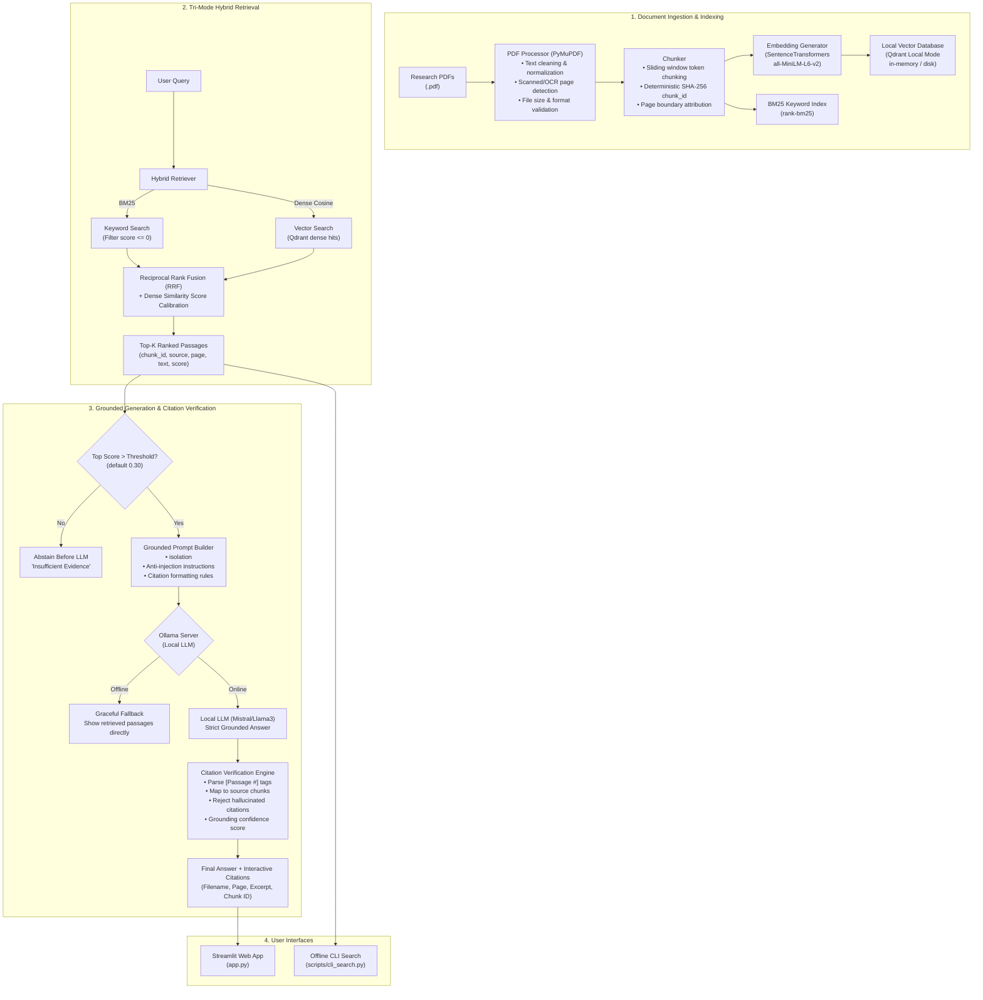

# ResearchPilot 🧭

**An evidence-grounded research paper assistant built with Retrieval-Augmented Generation (RAG).**  
*100% Python, local-first, free & open-source.*

[](https://www.python.org/downloads/)
[](LICENSE)
[](tests/)
[](#key-principles)

ResearchPilot is an evidence-grounded literature assistant designed to help researchers read, query, and verify technical papers without hallucination or privacy leaks. It extracts text from PDFs, indexes documents locally, retrieves passages using hybrid search (BM25 + Dense Semantic vectors via Reciprocal Rank Fusion), and generates grounded answers citing specific passage numbers that link back to the exact source page and paragraph.

---

## Key Principles & Engineering Guarantees

1. **Evidence-Grounded**: Every factual claim generated by the system must cite a numbered evidence passage (`[Passage #]`).
2. **Active Abstention**: If retrieved evidence is weak or irrelevant (below confidence threshold) or if the paper does not contain the answer, the system abstains (`"I cannot answer this question based on the provided evidence."`) rather than fabricating information.
3. **Passive Data Hygiene**: PDF text is treated strictly as passive data inside `<evidence_data>` tags, never as executable instructions to the LLM (mitigating indirect prompt injection).
4. **Local & Private**: Runs entirely on your local machine using PyMuPDF, Sentence Transformers, Qdrant local mode, and local Ollama models. Zero telemetry, zero external API keys required.
5. **Verifiable Citations**: A dedicated verification engine maps all answer citations back to stored chunks, rejects out-of-bounds citations, and extracts source metadata (filename, page number, chunk ID, and exact text).
6. **Empirical Measurement**: Zero invented performance numbers. All reported metrics are measured empirically using our built-in evaluation framework.

---

## System Architecture



---

## User Interface & Screenshots

### 1. Document Upload & Processing
Upload multiple research PDFs simultaneously with real-time progress indicators, automatic duplicate detection, and scanned page / OCR warnings.


*(Placeholder: Upload panel displaying file parsing, chunk count, and OCR status)*

### 2. Evidence-Grounded Q&A with Interactive Citations
Ask research questions, select retrieval mode (Keyword, Semantic, Hybrid), and explore verified source citations with file names, page numbers, and exact excerpts.


*(Placeholder: Grounded answer panel with expandable citation cards and human verification warning)*

### 3. Evaluation & Benchmarking Dashboard
Run automated Recall@K, MRR, Abstention Accuracy, and Citation Precision benchmarks directly inside the UI and export results as timestamped JSON and CSV reports.


*(Placeholder: Evaluation tab showing metric comparisons across Keyword, Semantic, and Hybrid modes)*

---

## Repository Structure

```
├── src/
│   ├── __init__.py
│   ├── pdf_processor.py   # PDF text extraction, normalization, and OCR warning heuristics
│   ├── chunker.py         # Configurable sliding-window chunking & deterministic chunk IDs
│   ├── embeddings.py      # Sentence Transformers embedding engine (all-MiniLM-L6-v2)
│   ├── vector_store.py    # Local Qdrant vector database (memory/persistent disk, hash deduplication)
│   ├── retriever.py       # Tri-mode retriever: Keyword (BM25), Semantic (Qdrant), Hybrid (RRF)
│   ├── generator.py       # Grounded prompt construction, anti-injection hygiene, Ollama client
│   ├── citations.py       # Bracket citation extraction, chunk mapping, and hallucination rejection
│   └── evaluator.py       # Evaluation framework: Recall@K, MRR, Abstention Accuracy, CSV/JSON export
├── tests/                 # Comprehensive test suite (61 tests covering all modules & integration)
│   ├── test_pdf_processor.py
│   ├── test_chunker.py
│   ├── test_embeddings.py
│   ├── test_vector_store.py
│   ├── test_retriever.py
│   ├── test_generator.py
│   ├── test_citations.py
│   ├── test_evaluator.py
│   ├── test_app.py
│   ├── test_skeleton.py
│   └── test_e2e_integration.py # Full integration & edge-case test suite
├── evaluation/
│   ├── questions.json     # Standardized evaluation questions benchmark template
│   └── results/           # Timestamped benchmark output artifacts (.json, .csv)
├── docs/
│   ├── architecture.md    # Detailed module design, data flow, and threat modeling
│   ├── evaluation.md      # Evaluation metrics, benchmark methodology, and measurement tables
│   ├── limitations.md     # Critical analysis of PDF extraction, retrieval, hallucination & small test sets
│   └── images/            # UI screenshot assets
├── scripts/
│   └── cli_search.py      # Standalone offline CLI search tool (Zero LLM / Zero API requirement)
├── app.py                 # Streamlit web user interface
├── requirements.txt       # Pinned production and development dependencies
├── .gitignore             # Strict exclusion of PDFs, databases, virtualenvs, models, and keys
└── README.md              # Project documentation and quickstart guide
```

---

## Getting Started

### Prerequisites
- **Python**: 3.10 or higher (Tested on Python 3.10 – 3.14 on Windows, macOS, and Linux).
- **Git**: For cloning the repository.
- *(Optional)* **Ollama**: For running local LLMs (e.g. `mistral`, `llama3`). Core retrieval, indexing, and offline search work with zero external dependencies.

---

### Step 1: Clone the Repository
```bash
git clone https://github.com/your-username/ResearchPilot.git
cd ResearchPilot
```

### Step 2: Create and Activate Virtual Environment

**On Windows (PowerShell):**
```powershell
python -m venv .venv
.\.venv\Scripts\Activate.ps1
```
*(If script execution is disabled on Windows PowerShell, run: `Set-ExecutionPolicy -Scope CurrentUser -ExecutionPolicy RemoteSigned`)*

**On Linux / macOS:**
```bash
python3 -m venv .venv
source .venv/bin/activate
```

### Step 3: Install Dependencies
```bash
pip install -r requirements.txt
```

### Step 4: (Optional) Set Up Local LLM with Ollama
If you wish to use the local generative answer model:
1. Download and install [Ollama](https://ollama.com/).
2. Pull a model (Mistral is used by default):
   ```bash
   ollama pull mistral
   ```
3. Ensure the Ollama server is running (default: `http://localhost:11434`).
*Note: If Ollama is not installed or running, ResearchPilot will gracefully fall back to direct evidence retrieval.*

---

## Usage

### 1. Launch the Streamlit Web Application
```powershell
python -m streamlit run app.py
```
Open your browser at `http://localhost:8501`.

- **Upload Tab**: Drag and drop one or more research PDFs. The app parses text, checks for scanned pages, computes document hashes, chunks text, and indexes dense vectors into Qdrant.
- **Search & Question Answering**: Enter a research question, pick your retrieval mode (`hybrid`, `semantic`, or `keyword`), adjust the Top-K slider, and view answers with interactive citations.
- **Evaluation Tab**: Select a question benchmark file, execute automated evaluation across all retrieval modes, inspect Recall@K and MRR tables, and export results.

---

### 2. Standalone CLI Search (No LLM Required)
Search a directory of PDFs directly from your terminal using hybrid, semantic, or keyword search:

```powershell
# Index sample documents and run hybrid search:
python scripts/cli_search.py --docs sample_documents/ --query "attention mechanism in neural networks" --mode hybrid --top-k 3

# Run BM25 keyword search:
python scripts/cli_search.py --docs sample_documents/ --query "transformer" --mode keyword --top-k 2

# Run Dense semantic vector search:
python scripts/cli_search.py --docs sample_documents/ --query "deep reinforcement learning rewards" --mode semantic --top-k 3
```

---

### 3. Run the Automated Test Suite
Execute the full pytest suite (61 tests covering unit, edge cases, and end-to-end integration):

```powershell
python -m pytest -v tests/
```

To run a specific test module:
```powershell
python -m pytest -v tests/test_e2e_integration.py
python -m pytest -v tests/test_retriever.py
```

---

### 4. Run Benchmark Evaluations
Run evaluation programmatically to measure Recall@K, MRR, Abstention Accuracy, and Citation Precision:

```powershell
python -c "from src.evaluator import run_full_evaluation; from src.retriever import HybridRetriever; from src.vector_store import VectorStore; from src.embeddings import EmbeddingGenerator; from src.generator import GroundedGenerator; store = VectorStore('eval_store'); embedder = EmbeddingGenerator(); ret = HybridRetriever(store, embedder); gen = GroundedGenerator(); rep = run_full_evaluation('evaluation/questions.json', ret, gen, top_k=3); print('Saved reports:', rep['saved_files'])"
```

Timestamped JSON and CSV results are automatically saved to `evaluation/results/`.

---

## Documentation Links

- **[Architecture Deep-Dive](docs/architecture.md)**: Detailed breakdown of every module, sequence diagrams, prompt injection defense, and state management.
- **[Evaluation Methodology & Results](docs/evaluation.md)**: Metric formulations (Recall@K, MRR, Abstention Accuracy, Citation Precision), benchmark schema, and empirical measurement tables.
- **[System Limitations & Failure Modes](docs/limitations.md)**: In-depth analysis of PDF extraction issues, retrieval failures, hallucination risks, citation errors, and small sample size caveats.

---

## License

This project is licensed under the MIT License — see the [LICENSE](LICENSE) file for details.
